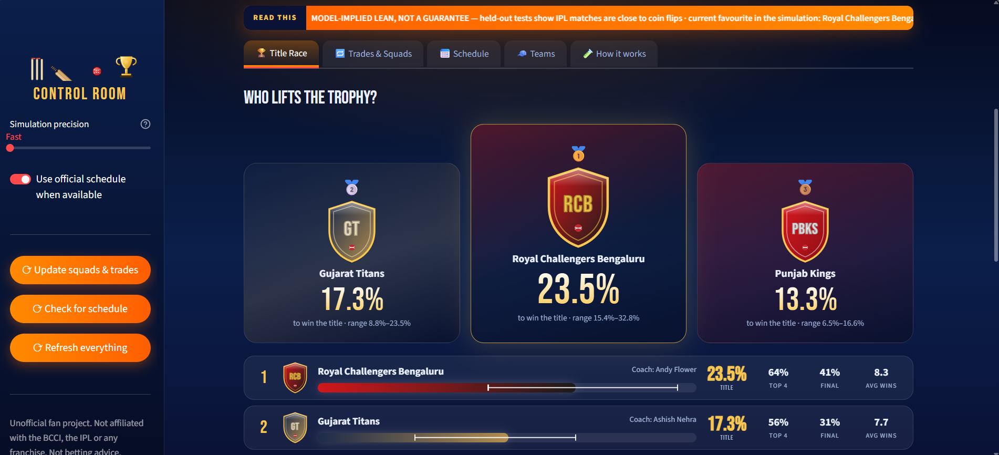
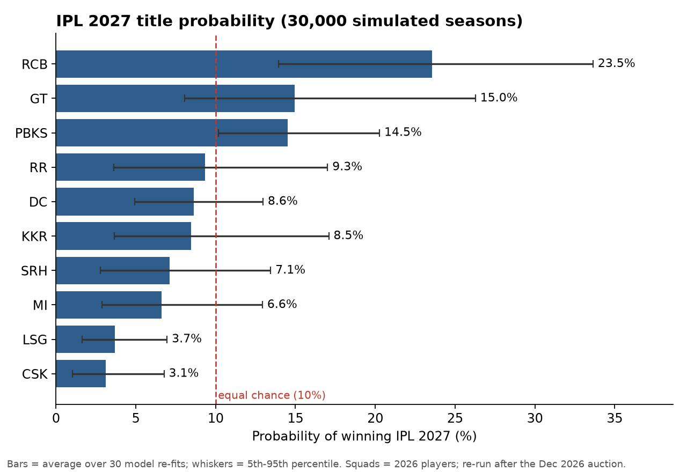
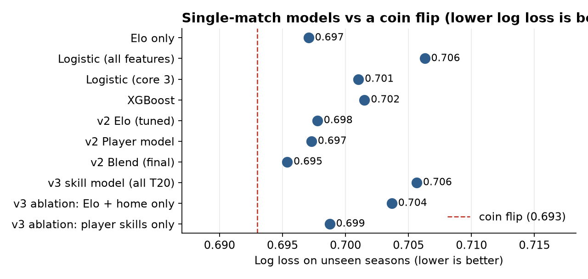

# IPL 2027 Title Predictor

An honest, walk-forward-tested IPL model with a season simulator and a live Streamlit dashboard that updates for **trades, squads and the schedule**.



**Live app:** https://ipl-2027-title-probabilities-analyzed.streamlit.app/

> **Headline finding:** I tested several model families (Elo, logistic regression, XGBoost, a player-impact model, and skill ratings built from every men's T20 match on Cricsheet) with strict walk-forward validation. **None beat a coin flip on unseen seasons.** IPL matches look close to unpredictable from public pre-match information, so the app reports **title probabilities with uncertainty ranges**, not a single pick.

## What the app does

- **Runs the forecast automatically** when you open it (3,200 simulated seasons at the default Fast setting, up to 30,000 on Full; results are cached).
- **Update squads & trades** reads current squads and coaches from the internet (Wikipedia team pages) and applies a ledger of confirmed trades (`squad_moves.csv`), then re-runs the forecast.
- **Check for schedule** probes the official IPL schedule feed. If the 2027 fixtures are not out, nothing changes and a generic 70-match format is used. Once a complete schedule exists, the forecast switches to the **real fixtures** with home/away games.
- **Trade Lab** lets you move any player to any team and see the model-implied change in title chances.
- **Simulation precision** (Fast / Standard / Full) trades speed for steadier numbers: it sets how many times the model is re-fitted on resampled history and how many seasons are simulated per re-fit (Fast = 8 x 400, Standard = 20 x 600, Full = 30 x 1,000).
- Coaches and squads are shown for context. The model uses the expected XI only.

## IPL 2027 title probabilities (snapshot)

Current squads (2026 squads plus the four confirmed trades), as of 14 Nov 2026, before the December 2026 auction. 30 model re-fits x 1,000 simulated seasons. Range = 5th-95th percentile. Equal chance would be 10% each. **The live app shows the current numbers.**

| Team | Title % | Range | Top-4 % |
|---|---|---|---|
| Royal Challengers Bengaluru | 23.5 | 13.9-33.6 | 64.9 |
| Gujarat Titans | 15.0 | 8.1-26.3 | 52.1 |
| Punjab Kings | 14.5 | 10.2-20.3 | 52.7 |
| Rajasthan Royals | 9.3 | 3.6-17.0 | 40.2 |
| Delhi Capitals | 8.6 | 4.9-13.0 | 39.4 |
| Kolkata Knight Riders | 8.5 | 3.7-17.1 | 38.1 |
| Sunrisers Hyderabad | 7.1 | 2.8-13.4 | 34.4 |
| Mumbai Indians | 6.6 | 2.9-12.9 | 34.2 |
| Lucknow Super Giants | 3.7 | 1.6-7.0 | 23.8 |
| Chennai Super Kings | 3.1 | 1.0-6.8 | 20.2 |

Read this as a model-implied lean, not a validated forecast: the ranges only reflect model-fitting uncertainty, and the model has not shown a significant edge over a coin flip.



## How well does it predict matches?

Walk-forward test on IPL 2022-2026 (360 matches; each season predicted using only earlier seasons; settings tuned on 2016-2021 only).

| Model | Accuracy | Log loss |
|---|---|---|
| Coin flip | 50.0% | 0.693 |
| Elo only | 48.6% | 0.697 |
| Logistic, all features | 47.2% | 0.706 |
| Logistic, 3 features | 49.4% | 0.701 |
| XGBoost | 48.9% | 0.702 |
| v2 Elo (tuned) | 49.2% | 0.698 |
| v2 Player-impact model | 51.9% | 0.697 |
| **v2 Blend (used in the app)** | **51.9%** | **0.695** |
| v3 skill model (all T20 data) | 43.9% | 0.706 |
| v3 Elo + home only | 45.8% | 0.704 |
| v3 player skills only | 46.9% | 0.699 |

Accuracy has a 95% margin of about +/-5 points. The v2 blend's log-loss gain over a coin flip is -0.002 (bootstrap 95% interval -0.009 to +0.005): not significant. Lower log loss is better.



## What I tried that did not work

**All-T20 skill ratings.** I rated every player on all men's T20 cricket (9,181 matches, 6,585 players), adjusted for competition and date. The full model scored 43.9% on the test seasons and was significantly worse than a coin flip, probably because 6 fitted parameters on about 900 matches add more estimation noise than the signal is worth.

**A final test with rules fixed in advance.** Four simple candidates, success = the 98.75% interval (corrected for 4 tests) for the log-loss gain over a coin flip above zero. Walk-forward over 973 matches (2012-2026):

| Candidate | Accuracy | Log loss | Gain vs coin flip (95% CI) |
|---|---|---|---|
| Home advantage only | 52.6% | 0.6931 | +0.0001 [-0.0053, +0.0051] |
| Elo with mega-auction resets | 51.9% | 0.6929 | +0.0002 [-0.0043, +0.0047] |
| Skill margin (T20 ratings) | 48.9% | 0.6947 | -0.0016 [-0.0068, +0.0038] |
| All three | 51.3% | 0.6946 | -0.0015 [-0.0090, +0.0057] |

None passed. With about 1,000 matches only edges of roughly 5 points of win probability can be detected, so "no measurable edge" is not "no edge". Sanity checks: the ratings look right (top bowlers by runs saved: Narine, Muralitharan, Nabi, Rashid Khan; top batters: Abhishek Sharma, Russell, Maxwell), and the toss winner wins only 51.6% of matches.

## Project structure

```
app.py                 Streamlit dashboard (entry point)
requirements.txt
src/                   pipeline scripts 01-15, engine.py (forecast engine), common.py, ui_art.py (SVG art)
inputs/                files you edit by hand: squad_moves.csv, coaches.csv, name_aliases.csv
live/                  refreshed by the scripts: squads_2027.csv, fixtures_2027.csv, frozen predictions
data/  results/  models/  charts/    generated outputs (only small files are committed)
assets/                screenshot (and optional official logos in assets/logos/)
.streamlit/config.toml dark theme
```

| Step | Script | What it does |
|---|---|---|
| 1 | `src/01_data_cleaning.py` | Downloads Cricsheet ball-by-ball data, builds match and player tables |
| 2 | `src/02_features.py` | Leak-free pre-match features (Elo, form, head-to-head, venue, XI strength) |
| 3 | `src/03_match_model.py` | First-generation models with walk-forward validation |
| 4 | `src/04_season_sim.py` | First season simulator; creates the 2026 baseline squads |
| 5 | `src/05_charts.py` | README charts |
| 6 | `src/06_player_model.py` | Tuned Elo + player-impact ridge model, bootstrap significance test |
| 7 | `src/07_season_sim_v2.py` | Season simulator with the v2 model and uncertainty ranges |
| 8-10 | `src/08_t20_data.py`, `src/09_t20_model.py`, `src/10_season_sim_v3.py` | All-T20 skill ratings model (did not beat a coin flip) |
| 11 | `src/11_forward_test.py` | Freezes predictions before the season, scores them as results arrive |
| 12-13 | `src/12_diagnostics.py`, `src/13_final_attempt.py` | Sanity checks and the pre-declared final test |
| 14 | `src/14_update_squads.py` | Squads, trades and coaches from the internet + ledger |
| 15 | `src/15_fetch_schedule.py` | Checks for the official 2027 schedule and saves it |
| - | `src/engine.py` | Shared forecast engine (app, CLI and forward test) |

## Run it locally

```
pip install -r requirements.txt
python src/01_data_cleaning.py
python src/02_features.py
python src/03_match_model.py
python src/04_season_sim.py
python src/06_player_model.py
python src/07_season_sim_v2.py
python src/14_update_squads.py
python src/15_fetch_schedule.py
python src/05_charts.py
python -m streamlit run app.py
```

## Keeping it current

- **Trades / auction:** `python src/14_update_squads.py` (or the app's sidebar button). Add `release` / `add` rows to `inputs/squad_moves.csv` if Wikipedia lags. Names it cannot match are listed in `data/squad_unmatched.csv` (fix in `inputs/name_aliases.csv`).
- **Schedule:** `python src/15_fetch_schedule.py`, or create `inputs/fixtures_2027_manual.csv` (`date,team_a,team_b,venue[,home,stage]`).
- **Forward test (the only fully honest test):** once fixtures exist, run `python src/11_forward_test.py predict` and commit `live/predictions_2027.csv` BEFORE the first ball; later `python src/11_forward_test.py score` compares it with real results.

## Limitations

- Only about 1,200 IPL matches and T20 is high-variance: no model here has a demonstrated edge over a coin flip.
- Player ratings share credit between team-mates and are not adjusted for powerplay / middle / death overs.
- Squads from Wikipedia can lag the news; the 3-feature first model and the v2 blend were chosen after seeing earlier results.
- Injuries, overseas availability, impact-player choices and pitch conditions are not modelled; coaches are shown but not used.
- Uncertainty ranges capture model-fitting uncertainty only.

## Data and disclaimer

Ball-by-ball data from [Cricsheet](https://cricsheet.org) (Open Data Commons licence); squads and coaches from Wikipedia and public news reports. Team badges are original drawings, not official logos. This is an unofficial fan analytics project, not affiliated with the BCCI, the IPL or any franchise, and not betting advice.
